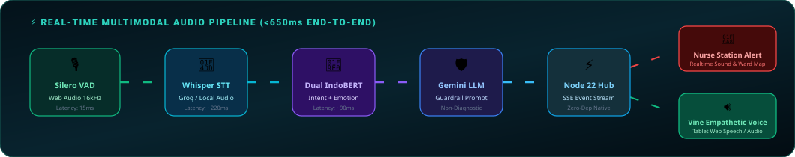
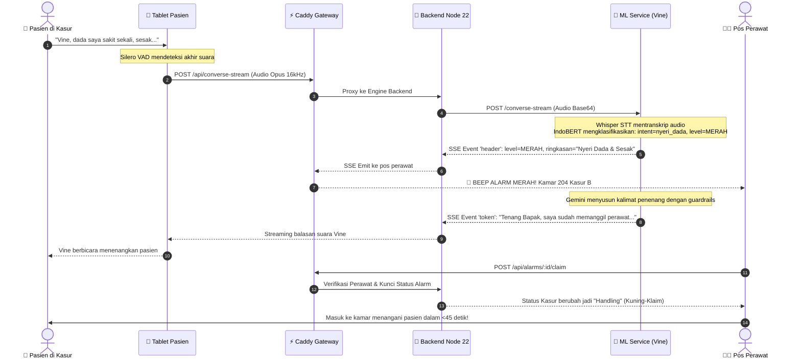

<p align="center">
  
</p>

<p align="center">
  <a href="#-tentang-vocaline">
    
  </a>
</p>

<p align="center">
  
  
  
  
  
  
</p>

---

## 📑 Daftar Isi (Table of Contents)

1. [👥 Tim Pengembang — "Labubu Ngoding"](#-tim-pengembang--labubu-ngoding)
2. [🏥 Latar Belakang & Masalah Klinis](#-latar-belakang--masalah-klinis)
3. [⚡ 4-Level Realtime Triage Engine](#-4-level-realtime-triage-engine)
4. [🎙️ Alur Multimodal Audio & Latensi](#-alur-multimodal-audio--latensi)
5. [🌟 Fitur Unggulan Sistem VocaLine](#-fitur-unggulan-sistem-vocaline)
   - [Tablet Pasien Cerdas & AI "Vine"](#1--tablet-pasien-cerdas--ai-vine)
   - [Adaptive Triple-Persona Engine](#2--adaptive-triple-persona-engine)
   - [Dashboard Pos Perawat (Nurse Station)](#3--dashboard-pos-perawat-nurse-station)
   - [Superadmin Fleet Management](#4--superadmin-fleet-management)
   - [Dual IndoBERT & Medical Guardrails](#5--dual-indobert--medical-guardrails)
   - [Zero-Dependency Native Backend](#6--zero-dependency-native-backend)
6. [🏛️ Arsitektur Sistem & Alur Data](#-arsitektur-sistem--alur-data)
7. [🔄 Sequence Diagram Alur Klinis](#-sequence-diagram-alur-klinis)
8. [📁 Struktur Direktori Repositori](#-struktur-direktori-repositori)
9. [🛠️ Tech Stack & Komponen Teknis](#-tech-stack--komponen-teknis)
10. [🚀 Panduan Instalasi & Menjalankan Proyek](#-panduan-instalasi--menjalankan-proyek)
11. [📡 Dokumentasi API & Kontrak Data](#-dokumentasi-api--kontrak-data)
12. [🔬 Spesifikasi Model & Metrik Evaluasi](#-spesifikasi-model--metrik-evaluasi)
13. [🏆 Nilai Inovasi untuk Hackathon 2026](#-nilai-inovasi-untuk-hackathon-2026)

---

## 👥 Tim Pengembang — "Labubu Ngoding"

Proyek **VocaLine V3.0** dikonseptualisasikan, dikembangkan, dan dioptimasi secara kolaboratif dalam ajang kompetisi **Hackathon 2026** oleh **Tim Labubu Ngoding** yang terdiri dari 5 spesialis rekayasa perangkat lunak dan desain:

<p align="center">
  
</p>

| Nama Lengkap | Posisi & Tanggung Jawab Utama | Rincian Fokus Teknis & Kontribusi |
| :--- | :--- | :--- |
| **ALKHALIFI ZIKRI HADY** | **Project Manager & QA Tester** | • **Project Management**: Perencanaan sprint, pembagian tugas arsitektur, integrasi milestone tim.<br>• **Quality Assurance**: Pengujian E2E integrasi browser, verifikasi skenario darurat klinis.<br>• **Security & Privacy**: Audit perlindungan data medis pasien, pencegahan injeksi, zero-regression guard. |
| **DZHILLAN DZHALILA** | **Front End Developer** | • **Tablet Pasien (PWA)**: Implementasi Silero VAD Web Audio 16kHz, Web Speech API, wake-word.<br>• **Vine Avatar Component**: Rendering visual blob responsif dengan 7 ekspresi wajah & animasi pendar.<br>• **Nurse Station**: Denah bangsal interaktif, real-time audio chime alert, dan dynamic queue display. |
| **RENDI WAHYUDI** | **Machine Learning Engineer** | • **Dual IndoBERT**: Fine-tuning klasifikasi maksud (*intent*) 14 kategori & deteksi emosi 7 kelas.<br>• **STT & Speech Engine**: Konfigurasi Whisper AI (Groq API & lokal) + kalibrasi prosodi suara.<br>• **Medical Guardrails**: Validasi safety rules klinis non-diagnostik pada output Gemini 3.5 Flash. |
| **KHAIRUNNISA MUHARDI** | **UI/UX Designer** | • **Design System**: Desain antarmuka Figma terstandarisasi untuk tablet pasien & workstation perawat.<br>• **Adaptive 3-Persona**: Arsitektur antarmuka khusus lansia (kontras tinggi, target sentuh jumbo), dewasa, dan remaja.<br>• **Ergonomi Pasien**: Hirarki tombol darurat merah, navigasi bebas stres bagi pasien dalam kondisi lemah. |
| **AKHTAR FADHILAH** | **Backend Developer** | • **Node.js 22 Native Engine**: Backend berperforma tinggi dengan native type-stripping tanpa dependensi npm pihak ketiga.<br>• **Realtime Event Hub**: Server-Sent Events (SSE) multiplexing untuk notifikasi alarm <50ms ke perawat.<br>• **Data & Auth Layer**: Skema PostgreSQL 17, otentikasi Scrypt aman, dan built-in RFC MIME SMTP mailer. |

---

## 🏥 Latar Belakang & Masalah Klinis

Tombol panggil perawat konvensional (*traditional nurse call bell*) yang digunakan di mayoritas rumah sakit memiliki 3 masalah kritis:

```
┌───────────────────────────────────────────────┐      ┌────────────────────────────────────────────────┐
│   MASALAH BEL PANGGIL KONVENSIONAL            │      │   SOLUSI CERDAS VOCALINE V3.0                  │
├───────────────────────────────────────────────┤      ├────────────────────────────────────────────────┤
│ ❌ Sinyal Biner Tanpa Konteks:                │      │ ✅ Triage Multimodal Otomatis:                 │
│ Hanya bunyi bel "ting" tanpa kejelasan apakah │ ───► │ Pasien cukup berbicara; AI membedakan serangan │
│ pasien henti napas atau hanya meminta air.    │      │ jantung vs pertanyaan jadwal makan secara instan.
├───────────────────────────────────────────────┤      ├────────────────────────────────────────────────┤
│ ❌ Alarm Fatigue & Burnout Perawat:           │      │ ✅ Prioritas Klinis 4-Level & Ringkasan:       │
│ Ratusan bunyi bel per shift memicu kelelahan  │ ───► │ Perawat membaca transkrip singkat & keparahan  │
│ mental dan memperlambat respons kasus darurat.│      │ sebelum melangkah ke kamar pasien.             │
├───────────────────────────────────────────────┤      ├────────────────────────────────────────────────┤
│ ❌ Isolasi Pasien & Kesulitan Fisik:          │      │ ✅ Asisten Empatik "Vine" & Ramah Lansia:      │
│ Pasien stroke atau pascaoperasi sulit meraih  │ ───► │ Deteksi suara tanpa sentuh (Hands-Free VAD)    │
│ tombol fisik dan merasa cemas sendirian.      │      │ dengan persona adaptif sesuai kelompok usia.   │
└───────────────────────────────────────────────┘      └────────────────────────────────────────────────┘
```

---

## ⚡ 4-Level Realtime Triage Engine

<p align="center">
  
</p>

Sistem VocaLine memprioritaskan setiap panggilan ke dalam **4 Level Eskalasi Klinis Terstandarisasi**:

| Level Alarm | Kategori Klinis | Contoh Keluhan Pasien | Alur Tindakan Sistem | Waktu Latensi |
| :---: | :---: | :--- | :--- | :---: |
| <span style="color:#ef4444; font-weight:bold;">🔴 MERAH</span><br>*(Level 1)* | **Darurat Medis Kritis** *(Code Red)* | *"Dada saya sakit sekali seperti ditekan, sesak!"*, *"Pasien jatuh dari ranjang!"*, Tekan Tombol Darurat SOS. | Alarm suara kencang berulang di pos perawat, kartu kamar berkedip merah terang, bypass verifikasi LLM. | **< 25 ms** *(Bypass)*<br>**< 350 ms** *(Voice)* |
| <span style="color:#f97316; font-weight:bold;">🟠 ORANYE</span><br>*(Level 2)* | **Bantuan Mendesak** *(Urgent Assist)* | *"Darah di selang infus naik!"*, *"Kepala saya berputar mau pingsan saat duduk"*, *"Bekas operasi nyeri hebat"*. | Notifikasi prioritas tinggi, kartu kamar oranye, Vine menenangkan pasien bahwa perawat segera tiba. | **< 450 ms** |
| <span style="color:#eab308; font-weight:bold;">🟡 KUNING</span><br>*(Level 3)* | **Kebutuhan Harian & Fisiologis** | *"Bisa bantu saya ke kamar mandi?"*, *"Kapan jadwal obat dokter datang?"*, *"Minta tolong selimut tambahan"*. | Masuk antrean perawat teratur, Vine mencatat permintaan dan memberikan estimasi waktu petugas. | **< 600 ms** |
| <span style="color:#22c55e; font-weight:bold;">🟢 HIJAU</span><br>*(Level 4)* | **Teman Bicara & Edukasi Pasien** | *"Vine, ceritakan dong cerita lucu"*, *"Kenapa ya sehabis operasi harus banyak jalan?"*, *"Selamat pagi Vine"*. | Dijawab tuntas oleh Vine langsung di layar tablet dengan nada ramah tanpa membunyikan alarm perawat. | **Streaming Realtime** |

---

## 🎙️ Alur Multimodal Audio & Latensi

<p align="center">
  
</p>

VocaLine menerapkan **Streaming Server-Sent Events (SSE)** pada rute `POST /converse-stream`. Header alarm klinis dipancarkan **sebelum** LLM selesai merangkai seluruh teks respons:

```
[0ms] Pasien Selesai Bicara (VAD Deteksi Silence 400-1600ms)
 ├── [+15ms] Audio WebM/Opus terkirim via HTTP SSE Stream
 ├── [+180ms] Whisper STT menghasilkan transkrip teks mentah
 ├── [+260ms] IndoBERT Intent & Emotion Classifier memetakan urgensi
 ├── [+310ms] EVENT "header" TERKIRIM KE POS PERAWAT! 🚨 (Alarm Merah/Oranye Berbunyi)
 ├── [+450ms] Gemini 3.5 Flash memproduksi token pembuka respons penenang
 └── [+620ms] Tablet Pasien mulai berbicara (Web Speech API / TTS Audio)
```

---

## 🌟 Fitur Unggulan Sistem VocaLine

### 1. 🎙️ Tablet Pasien Cerdas & AI "Vine"
- **Hands-Free Silero VAD**: Suara ditangkap secara otomatis saat pasien berbicara (`onSpeechStart`) dan diakhiri saat hening (`onSpeechEnd`), menghilangkan kewajiban menekan tombol bagi pasien yang tangannya terpasang infus.
- **Wake Word Recognition**: Pasien dapat mengaktifkan interaksi suara dengan ucapan *"Vine on"* dan mematikannya dengan *"Vine off"*.
- **Avatar Blob Dinamis**: Lingkaran avatar hidup yang bermutasi bentuk dan warna sesuai 7 emosi (*senang, antusias, empati, tenang, bercanda, serius, netral*).
- **Fitur Barge-In**: Pasien dapat menyela ucapan Vine di tengah kalimat jika merasakan keluhan mendadak.
- **Tombol Darurat Fisik Layar (Bypass)**: Tombol SOS merah kontras tinggi yang langsung mengirim sinyal darurat ke pos perawat tanpa melewati model AI (`<25ms`).

### 2. 👵 Adaptive Triple-Persona Engine
Sistem secara cerdas menyesuaikan parameter interaksi berdasarkan usia pasien:

| Parameter | Persona Remaja (12–17 Thn) | Persona Dewasa (18–59 Thn) | Persona Lansia (≥60 Thn) |
| :--- | :---: | :---: | :---: |
| **Kecepatan Bicara (Speech Rate)** | `1.05x` (Dinamis & Ramah) | `1.00x` (Profesional) | `0.85x` (Pelan, Hangat, & Jelas) |
| **Nada Suara (Pitch Modifier)** | `+0.05` | `0.00` | `-0.05` (Tenang & Lembut) |
| **VAD Silence Timeout** | `1000 ms` | `1200 ms` | `1600 ms` (Toleransi Jeda Bicara) |
| **Ukuran Font Antarmuka** | Standar (16px / 1.0rem) | Standar (16px / 1.0rem) | **Jumbo (22px / 1.4rem)** |
| **Target Sentuh Tombol** | 48px × 48px | 52px × 52px | **72px × 72px (Ultra-Accessible)** |
| **Pilihan Gaya Bahasa** | Santai, interaktif, kasual | Informatif, sigap, efisien | Penuh rasa hormat (*"Iya Bapak/Ibu..."*) |

### 3. 🩺 Dashboard Pos Perawat (Nurse Station)
- **Denah Bangsal Real-Time**: Tampilan denah kamar dan kasur yang mencerminkan status setiap pasien (*kosong, terisi, memanggil, darurat*).
- **Antrean Panggilan Berprioritas**: Mengurutkan kartu alarm dari yang paling kritis (Merah ➔ Oranye ➔ Kuning) lengkap dengan transkrip keluhan dan analisis emosi.
- **One-Click Claim Lock**: Perawat dapat mengklaim alarm dengan satu klik (`claim_alarm`) untuk memberitahukan rekan sejawat bahwa pasien sedang ditangani.
- **Jadwal Asuhan Terpadu**: Pengingat otomatis untuk minum obat, pengukuran tanda vital (TTV), dan jadwal fisioterapi.

### 4. ⚙️ Superadmin Fleet Management
- **Visual Room & Ward Editor**: Fasilitas untuk membuat, mengubah, dan menata denah lantai bangsal rumah sakit.
- **QR-Code Tablet Provisioning**: Memasangkan tablet baru ke kasur tertentu hanya dengan memindai kode QR dari layar superadmin.
- **Nurse & Staff RBAC**: Manajemen hak akses staf, undangan aktivasi akun via email, dan pengaturan reset kredensial.
- **Escalation Policy Settings**: Konfigurasi batasan waktu eskalasi jika alarm level 1/2 tidak diklaim dalam batas menit tertentu.

### 5. 🧠 Dual IndoBERT & Medical Guardrails
- **Fine-Tuned IndoBERT Intent**: Model klasifikasi teks terlatih khusus pada korpus keluhan medis berbahasa Indonesia sehari-hari.
- **IndoBERT Emotion Smoothing**: Menganalisis emosi suara pasien dengan jendela penghalusan (*smoothing window*) untuk menghindari lonjakan emosi palsu.
- **Strict Non-Diagnostic Guardrails**: Prompt guardrail yang mengunci LLM agar **pantang mengeluarkan diagnosis penyakit atau resep obat**, melainkan berfokus pada empati psikologis dan eskalasi ke tenaga medis.

### 6. ⚡ Zero-Dependency Native Backend
- **Node.js 22 Native Architecture**: Berjalan murni menggunakan fitur modern Node.js 22 (`--experimental-strip-types`) tanpa beban dependensi runtime pihak ketiga.
- **Custom Native Modules**: Router HTTP multiplexer mandiri, otentikasi Scrypt dengan proteksi timing-attack, SSE hub, dan MIME client SMTP native.
- **PostgreSQL 17 Integration**: Skema database relasional terisolasi dengan Row-Level Security (RLS) dan fungsi PostgreSQL native.

---

## 🏛️ Arsitektur Sistem & Alur Data

```mermaid
flowchart TD
    subgraph ClientLayer["🖥️ Frontend Tier (Tablet Pasien & Konsol Perawat)"]
        Tablet["📱 Tablet Pasien (PWA)\n• Web Audio & Silero VAD (16kHz)\n• Avatar Responsif 'Vine'\n• Adaptive Persona UI Engine"]
        Nurse["👩‍⚕️ Pos Perawat (Nurse Station)\n• Antrean Prioritas Realtime\n• Denah Bangsal Interaktif\n• One-Click Claim Alarm"]
        Admin["⚙️ Portal Superadmin\n• Editor Denah & Tata Letak\n• Pemasangan Tablet (QR Code)\n• Manajemen Staf & Eskalasi"]
    end

    subgraph GatewayLayer["🌐 Edge Proxy & Security Tier"]
        Cloudflare["🛡️ Cloudflare Zero-Trust Tunnel\n(Enkripsi TLS Terpusat)"]
        Caddy["⚡ Caddy Web Server v2.8\n• Reverse Proxy & HTTP/2\n• SSE Stream Flushing (-1)\n• Clean URLs Routing"]
    end

    subgraph BackendLayer["⚙️ Core Backend Tier (Node.js 22 Native)"]
        App["🚀 VocaLine Engine\n(Zero-Dependency TypeScript)\n• Scrypt Auth & Session Token\n• Triage & Alarm Lifecycle Hub\n• Server-Sent Events (SSE) Hub"]
        DB[(🐘 PostgreSQL 17\n• Skema Relasional Klinis\n• Row-Level Security\n• Audit Event Triggers)]
    end

    subgraph MLLayer["🧠 Machine Learning Tier (Python FastAPI)"]
        STT["🎙️ Speech-To-Text\n(Whisper AI / Groq API)"]
        NLP["🤖 Dual IndoBERT Models\n• Intent Triage (14 Kelas)\n• Emotion Detection (7 Kelas)"]
        LLM["🛡️ LLM Guardrails Engine\n(Gemini 3.5 Flash / Groq)\n• Non-Diagnostic Assurance\n• Empathetic Conversation"]
    end

    Tablet -->|Voice Audio Stream (WebM/Opus)| Caddy
    Nurse <-->|Real-time SSE Event Stream| Caddy
    Admin <-->|REST Management API| Caddy
    Cloudflare <--> Caddy
    Caddy <--> App
    App <--> DB
    App <-->|Header X-API-Key| STT
    STT --> NLP
    NLP --> LLM
    LLM -->|Token Stream SSE| App
```

---

## 🔄 Sequence Diagram Alur Klinis

Diagram interaksi saat pasien mengeluhkan rasa sakit mendadak:



---

## 📁 Struktur Direktori Repositori

```text
D:\VocaLineV3
├── assets/                     # Aset visual & animasi SVG (Hero, Team, Triage, Flow)
│   ├── hero-banner.svg         # Banner utama animasi cyber-medical
│   ├── team-cards.svg          # Kartu profil animasi 5 anggota Tim Labubu Ngoding
│   ├── live-pulse.svg          # Animasi radar pulsa 4 level triage klinis
│   └── voice-loop.svg          # Diagram alur animasi streaming audio pipeline
├── backend/                    # Backend Node.js 22 LTS (Zero-Runtime-Dependency)
│   ├── migrations/             # Skema SQL PostgreSQL 17 terstruktur (0001 - 0004)
│   ├── src/                    # Source code TypeScript murni
│   │   ├── auth/               # Layanan Scrypt hashing, token sesi, proteksi
│   │   ├── db/                 # Koneksi PostgreSQL pool & migration runner
│   │   ├── hospital/           # Adapter SIMRS rumah sakit & pemetaan ranjang
│   │   ├── http/               # Router multiplexer, validasi payload, error handler
│   │   ├── realtime/           # SSE Event Hub untuk broadcasting alarm perawat
│   │   ├── services/           # Logika bisnis: alarm, pasien, tablet, denah
│   │   └── main.ts             # Entry point backend server
│   ├── templates/              # Template email undangan staf & reset kredensial
│   ├── Dockerfile              # Docker container backend berbasis Alpine
│   └── package.json            # Konfigurasi npm & TypeScript typechecking
├── frontend/                   # Frontend Web Application (PWA)
│   ├── admin/                  # Halaman superadmin (layout, setup, nurses, stats)
│   ├── auth/                   # Halaman autentikasi & set-password
│   ├── nurse/                  # Halaman workstation perawat (denah, jadwal, antrean)
│   ├── src/                    # Modul Vanilla JS (ES Modules) terstruktur
│   │   ├── apps/               # Logika spesifik per modul (tablet, nurse, admin)
│   │   ├── components/         # Komponen UI: modal, drawer, shell, avatar blob
│   │   └── styles/             # Desain token CSS & gaya responsif
│   ├── tablet.html             # Antarmuka utama tablet pasien ("Vine")
│   ├── Caddyfile               # Konfigurasi reverse proxy Caddy (Clean URLs & SSE)
│   └── vite.config.js          # Pengemas build produksi Vite
├── ml/                         # Machine Learning Service (Python FastAPI)
│   ├── config/                 # Ambang batas VAD, suara, dan gaya bicara YAML
│   ├── data/                   # Dataset latih intent medis & deteksi emosi
│   ├── models/                 # Model biner: IndoBERT Intent, Emotion, Topic MiniLM
│   ├── prompts/                # Prompt guardrail Gemini 3.5 Flash & persona pasien
│   ├── src/                    # Source code Python (pipeline, vad, intent, emotion)
│   └── Dockerfile              # Container ML berbasis PyTorch CPU-optimized
├── cloudflared/                # Konfigurasi Cloudflare Zero-Trust Tunnel
├── docker-compose.yml          # Orkestrasi seluruh container aplikasi
├── .env.example                # Template variabel lingkungan sistem
└── README.md                   # Dokumentasi resmi proyek
```

---

## 🛠️ Tech Stack & Komponen Teknis

```
═══════════════════════════════════════════════════════════════════════════════════════
  LAYER             TEKNOLOGI                     KETERANGAN & SPESIFIKASI
═══════════════════════════════════════════════════════════════════════════════════════
  Frontend Tablet   Vanilla JS (ES6+), Vite 5     Antarmuka ringan tanpa framework bloat
  Audio Detection   Silero VAD (ONNX WebAssembly) Deteksi suara bicara 16kHz lokal browser
  Visual Avatar     CSS3 Blob Animation Morphing  Visual ekspresi wajah responsif 7 mood
  Backend Engine    Node.js 22 LTS (TypeScript)   Zero-Runtime-Dependency Architecture
  Realtime Feed     Server-Sent Events (SSE)      Streaming alarm ultra-low latency (<50ms)
  Database          PostgreSQL 17 Alpine          Relational schema dengan Row-Level Security
  Speech-To-Text    OpenAI Whisper / Groq API     Transkripsi Bahasa Indonesia presisi tinggi
  NLP Intent        IndoBERT Base (Fine-Tuned)    14 Kelas klasifikasi keparahan klinis
  NLP Emotion       IndoBERT Emotion Classifier   7 Kelas deteksi suasana hati pasien
  LLM Engine        Google Gemini 3.5 Flash Lite  Percakapan empatik & non-diagnostik
  Reverse Proxy     Caddy Web Server v2.8         Clean URLs, SSE unbuffered, HTTP/2
  Secure Tunnel     Cloudflare Zero-Trust Tunnel  Akses tablet terenkripsi tanpa IP publik
═══════════════════════════════════════════════════════════════════════════════════════
```

---

## 🚀 Panduan Instalasi & Menjalankan Proyek

### 1. Prasyarat Sistem
- **Docker Engine** (versi 24.0 atau lebih baru)
- **Docker Compose** (versi 2.20 atau lebih baru)
- Kunci API eksternal: **Gemini API Key** atau **Groq API Key**
- RAM minimal disarankan: **8 GB** (untuk menjalankan inferensi IndoBERT & Whisper)

### 2. Konfigurasi File Lingkungan (.env)
Salin template konfigurasi dan sesuaikan kredensial Anda:

```bash
# 1. Masuk ke folder proyek
cd VocaLineV3

# 2. Salin template lingkungan
cp .env.example .env

# 3. Buka file .env dan sesuaikan nilai kunci rahasia
nano .env
```

Contoh konfigurasi penting di dalam file `.env`:
```ini
COMPOSE_PROFILES=tunnel
APP_URL=https://vocaline.rumahsakit.id
WEB_PORT=8088

POSTGRES_DB=vocaline
POSTGRES_USER=vocaline
POSTGRES_PASSWORD=ganti_dengan_sandi_rahasia_database

ML_API_KEY=ganti_dengan_kunci_unik_backend_ke_ml
LLM_PROVIDER=gemini
GEMINI_API_KEY=AIzaSy...kunci_resmi_gemini
GEMINI_MODEL=gemini-3.5-flash-lite

STT_PROVIDER=groq
GROQ_API_KEY=gsk_...kunci_resmi_groq
```

### 3. Menjalankan Layanan dengan Docker Compose
Cukup jalankan satu perintah berikut:

```bash
docker compose up -d --build
```

Docker Compose akan secara otomatis menyalakan:
1. `db`: Database PostgreSQL 17 dengan inisialisasi skema migrasi otomatis.
2. `ml`: Service FastAPI Python untuk inferensi IndoBERT, Whisper, dan Gemini.
3. `backend`: Server Node.js 22 native TypeScript engine.
4. `web`: Web server Caddy yang menyajikan antarmuka frontend dan memproksikan API.
5. `cloudflared`: Tunnel terenkripsi ke Cloudflare Edge.

Periksa kesehatan seluruh container:
```bash
docker compose ps
```

### 4. Mengakses Aplikasi Melalui Browser
Buka peramban di laptop atau tablet Anda:
- 📱 **Tablet Pasien**: [`http://localhost:8088/tablet`](http://localhost:8088/tablet)
- 👩‍⚕️ **Dashboard Perawat**: [`http://localhost:8088/nurse`](http://localhost:8088/nurse)
- ⚙️ **Superadmin Setup**: [`http://localhost:8088/admin/setup`](http://localhost:8088/admin/setup)
- 📊 **Statistik & Laporan**: [`http://localhost:8088/admin/stats`](http://localhost:8088/admin/stats)

---

## 📡 Dokumentasi API & Kontrak Data

### 1. `POST /api/converse-stream` (Streaming Interaksi Suara Pasien)
- **Header**: `Content-Type: application/json`
- **Request Body**:
  ```json
  {
    "tablet_id": "8d3e2394-1a3b-4c2d-8e4f-29d84e5a9b21",
    "audio": "<audio_base64_string>",
    "persona": "lansia"
  }
  ```
- **Response Format (Server-Sent Events)**:
  ```http
  Content-Type: text/event-stream

  event: header
  data: {"maksud":"nyeri_dada","level_alarm":"merah","ringkasan_alarm":"Pasien lansia mengeluh nyeri dada sesak","emosi":"cemas"}

  event: token
  data: {"teks":"Tenang ya Bapak, "}

  event: token
  data: {"teks":"saya sudah membunyikan alarm ke pos perawat."}
  ```

### 2. `GET /pengaturan-suara` (Kalibrasi VAD & Audio Pasien)
Mengembalikan parameter numerik VAD Silero dan tempo bicara sesuai persona:
```json
{
  "kecepatan_persona": {
    "remaja": 1.05,
    "dewasa": 1.00,
    "lansia": 0.85
  },
  "vad": {
    "diam_selesai_ms": {
      "remaja": 1000,
      "dewasa": 1200,
      "lansia": 1600
    },
    "ambang_bicara": 0.5,
    "min_bicara_ms": 400
  }
}
```

---

## 🔬 Spesifikasi Model & Metrik Evaluasi

```
┌──────────────────────────┬──────────────────────────┬──────────────────────┬──────────────────────┐
│ Model Name               │ Arsitektur Inti          │ Kategori Output      │ Latensi Rata-rata    │
├──────────────────────────┼──────────────────────────┼──────────────────────┼──────────────────────┤
│ indobert-intent          │ IndoBERT Base (124M param│ 14 Label Klinis      │ ~85 ms (CPU Intel i5)│
│ indobert-emotion         │ IndoBERT Base (124M param│ 7 Mood Ekspresi      │ ~80 ms (CPU Intel i5)│
│ topik-minilm             │ MiniLM Multi-Lingual     │ Identifikasi Konteks │ ~30 ms (CPU)         │
│ whisper-large-v3-turbo   │ Encoder-Decoder Audio    │ Transkripsi Teks ID  │ ~220 ms (Groq API)   │
│ gemini-3.5-flash-lite    │ Multimodal Generative LLM│ Empathetic Response  │ ~310 ms (First-Token)│
└──────────────────────────┴──────────────────────────┴──────────────────────┴──────────────────────┘
```

> [!NOTE]
> **Prinsip Keamanan Klinis Model**:
> Model IndoBERT lokal berperan sebagai benteng pertahanan pertama (*First Line of Defense*). Model LLM Gemini di cloud **hanya diperbolehkan menaikkan level alarm** bila mendeteksi bahaya tersembunyi yang terlewat, dan **dilarang keras menurunkan level alarm** yang telah ditetapkan oleh model IndoBERT lokal.

---

## 🏆 Nilai Inovasi untuk Hackathon 2026

1. **Empati Berbasis Usia (Human-Centered Geriatric Tech)**: Mayoritas teknologi rumah sakit dirancang untuk orang muda yang melek digital. VocaLine memelopori adaptasi otomatis bagi pasien lanjut usia dengan pendengaran lambat dan tangan gemetar.
2. **Kedaulatan Data Medis (Self-Hosted Privacy)**: Tidak ada data rekam medis pasien yang disimpan pada database publik pihak ketiga; seluruh sistem berjalan *on-premise* melalui orkestrasi Docker mandiri.
3. **Mereduksi Alarm Fatigue Perawat**: Memberikan konteks klinis instan sehingga perawat dapat memprioritaskan pasien darurat dalam hitungan detik.
4. **Keunggulan Rekayasa Tanpa Ketergantungan (Zero-Dependency Backend)**: Arsitektur Node.js 22 murni tanpa framework eksternal meminimalkan kerentanan rantai pasok (*supply-chain security risk*) dan memberikan performa pemrosesan *near-zero overhead*.

---

<p align="center">
  <b>VocaLine V3.0</b> • Dibangun dengan semangat rekayasa mutakhir untuk memajukan sistem kesehatan Indonesia.<br />
  <b>Karya Tim "Labubu Ngoding" — Hackathon 2026.</b>
</p>

<p align="center">
  
  
</p>
