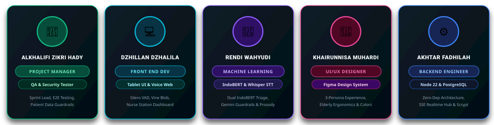
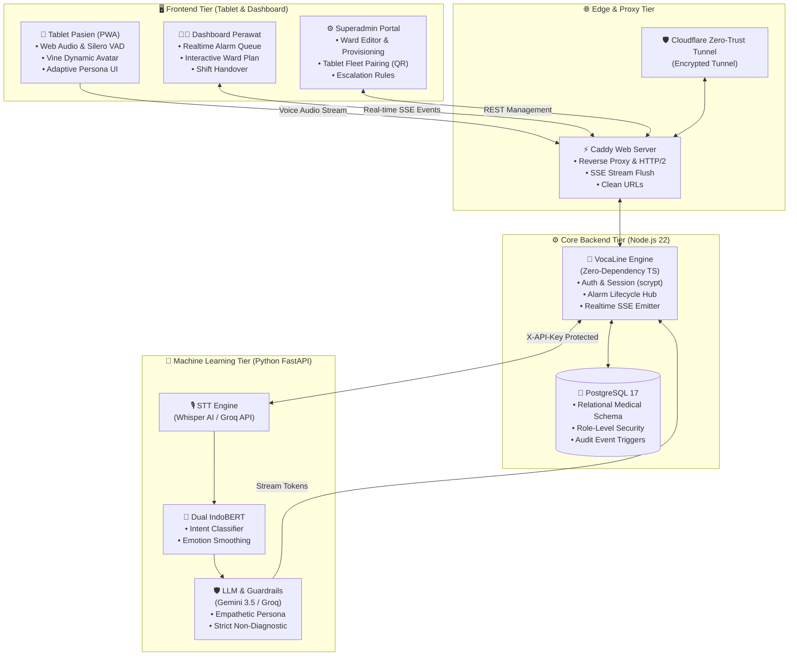

<p align="center">
  
</p>

<p align="center">
  <a href="#-tentang-vocaline">
    
  </a>
</p>

<p align="center">
  
  
  
  
  
</p>

---

## 👥 Tim Pengembang — "Labubu Ngoding"

Proyek ini dirancang, dibangun, dan dioptimasi secara kolaboratif dalam ajang **Hackathon 2026** oleh **Tim Labubu Ngoding** yang beranggotakan 5 talenta multidisiplin:

<p align="center">
  
</p>

| Nama Anggota | Peran Utama | Fokus Kontribusi &amp; Tanggung Jawab Teknis |
| :--- | :--- | :--- |
| **ALKHALIFI ZIKRI HADY** | **Project Manager &amp; QA Tester** | • *Project Roadmap, Sprint Orchestration, Risk Mitigation*<br>• *End-to-End System Integration Testing &amp; Stress Testing*<br>• *Security Auditing, Patient Data Privacy Guardrails, Zero-Regression Lead* |
| **DZHILLAN DZHALILA** | **Front End Developer** | • *Tablet Pasien PWA: Voice Activity Detection (Silero VAD) &amp; Web Audio*<br>• *Komponen Avatar Responsif "Vine" (Blob morphing &amp; 7 emosi visual)*<br>• *Dashboard Perawat Real-time, Denah Bangsal Interaktif, dan Admin Portal* |
| **RENDI WAHYUDI** | **Machine Learning Engineer** | • *Fine-Tuning Dual Model IndoBERT (Intent &amp; Emotion Classifier)*<br>• *Arsitektur Streaming Speech-to-Text (Whisper AI via Groq &amp; Lokal)*<br>• *Medical Safety Guardrails System &amp; Dynamic Voice Calibration Engine* |
| **KHAIRUNNISA MUHARDI** | **UI/UX Designer** | • *Figma Design System: Desain Ergonomis Tablet Pasien &amp; Nurse Station*<br>• *Adaptive Triple-Persona Engine (Spesifikasi Lansia, Dewasa, Remaja)*<br>• *Aksesibilitas Tinggi: High Contrast, Target Sentuh Ramah Pasien Lemah* |
| **AKHTAR FADHILAH** | **Backend Developer** | • *Native Node.js 22 Backend dengan Zero-Runtime-Dependency Architecture*<br>• *Realtime Event Hub (Server-Sent Events) &amp; Ultra-Low Latency State Sync*<br>• *PostgreSQL 17 Native Migration, Scrypt Auth, &amp; Built-in SMTP Engine* |

---

## 🏥 Latar Belakang &amp; Masalah (The Clinical Problem)

Di ruang rawat inap rumah sakit konvensional, tombol panggilan perawat (*traditional nurse call bell*) memiliki kelemahan mendasar:
1. **Sinyal Biner Tanpa Konteks**: Perawat hanya mendengar bunyi bel "ting" tanpa mengetahui urgensi pasien (apakah darurat serangan jantung, infus habis, atau hanya sekadar bertanya jadwal makan).
2. ***Alarm Fatigue &amp; Burnout***: Tenaga perawat kewalahan merespons ratusan alarm biner setiap giliran jaga, memicu kelelahan mental dan memperlambat waktu tanggap (*response time*) pada kondisi kritis.
3. **Isolasi &amp; Kecemasan Pasien**: Pasien sering merasa terasing dan cemas di kasur perawatan, terutama lansia yang kesulitan menekan tombol fisik kecil atau kesulitan menyampaikan keluhan secara artikulatif.

> [!IMPORTANT]
> **Solusi VocaLine**: Mengubah bel konvensional menjadi **asisten suara cerdas & sistem triage klinis multimodal**. Pasien cukup berbicara secara alami dari kasur, kecerdasan buatan memahami maksud serta tingkat keparahan, mengelompokkan prioritas alarm secara otomatis, dan menyampaikan ringkasan konteks ke pos perawat **dalam hitungan milidetik**.

---

## ⚡ Live Triage Engine &amp; Skema Prioritas

<p align="center">
  
</p>

Sistem VocaLine membagi setiap interaksi suara pasien ke dalam **4 Tingkat Eskalasi Klinis**:

```
[Suara Pasien] ──► VAD ──► Whisper STT ──► Dual IndoBERT ──► Safety Engine
                                                                    │
           ┌──────────────────────┬──────────────────────┬──────────┴───────────┐
           ▼                      ▼                      ▼                      ▼
      🔴 MERAH               🟠 ORANYE              🟡 KUNING              🟢 HIJAU
     (Level 1)              (Level 2)              (Level 3)              (Level 4)
  Darurat Kritis       Bantuan Mendesak       Kebutuhan Harian       Percakapan Ramah
  (Nyeri Dada, Jatuh,    (Infus Bocor/Darah,    (Tanya Jadwal Obat,    (Teman Ngobrol,
   Sesak, Tombol SOS)     Pusing Berat, Mual)    Bantu ke Toilet)       Edukasi Pasien)
           │                      │                      │                      │
     🚨 Alarm Keras        ⚠️ Notifikasi Cepat     📋 Masuk Antrean       💬 Dijawab Vine
     Bypass ke Monitor       ke Dashboard          Perawat Terjadwal       Langsung di Tablet
```

---

## 🌟 Fitur Unggulan Proyek

### 1. 🎙️ Tablet Pasien Cerdas &amp; AI "Vine"
- **Deteksi Bicara Bebas Sentuh (VAD)**: Memanfaatkan Silero VAD pada browser untuk mendengarkan saat pasien mulai bicara dan otomatis berhenti saat hening, tanpa perlu menekan tombol secara terus-menerus.
- **Wake Word Recognition**: Mendukung pemanggilan nama *"Vine on"* dan perintah tidur *"Vine off"*.
- **Avatar Emosional Responsif**: Avatar visual blob yang berubah bentuk dan warna (*senang, antusias, empati, tenang, bercanda, serius, netral*) mencerminkan suasana hati pasien dan meredakan kecemasan.
- **Barge-In (Interupsi Instan)**: Pasien dapat langsung memotong pembicaraan Vine kapan saja ketika merasakan keluhan mendadak.
- **Tombol Darurat Fisik Layar (Bypass)**: Tombol merah besar yang tidak melewati pemrosesan AI untuk memicu kode darurat instan dalam `<25ms`.

### 2. 👵 Adaptive Triple-Persona Engine
VocaLine secara otomatis mengadaptasi perilaku UI, nada bicara, kecepatan bicara (*speech rate*), dan pilihan kata berdasarkan usia pasien:
- **Lansia (≥60 tahun)**: Antarmuka kontras tinggi dengan tombol ekstra besar, tempo bicara Vine lebih lambat (0.85x), nada hangat penuh hormat (*"Iya Bapak/Ibu..."*), dan toleransi jeda bicara lebih panjang (1600ms).
- **Dewasa (18–59 tahun)**: Desain modern seimbang, tempo bicara normal (1.0x), komunikasi profesional dan informatif.
- **Remaja (12–17 tahun)**: Tipografi kasual, tempo bicara energik (1.05x), pilihan kata ramah, interaktif, dan bersahabat.

### 3. 🩺 Dashboard Pos Perawat (Nurse Station)
- **Denah Bangsal Real-time**: Visualisasi denah kamar dan kasur yang dapat dikonfigurasi melalui Superadmin Layout Editor.
- **Antrean Alarm Berprioritas**: Mengurutkan panggilan pasien berdasarkan keparahan (Merah ➔ Oranye ➔ Kuning) lengkap dengan transkrip keluhan, analisis emosi, dan ringkasan klinis otomatis.
- **One-Click Claim &amp; Resolve**: Perawat dapat langsung mengklaim alarm untuk mencegah redundansi respons antartenaga medis.
- **Jadwal Asuhan Terpadu**: Pengingat otomatis untuk minum obat, pengukuran tanda vital (TTV), dan pergantian cairan infus.

### 4. 🛡️ Dual-Engine NLP &amp; Medical Guardrails
- **IndoBERT Intent Classifier**: Mengklasifikasikan ucapan bahasa Indonesia sehari-hari, bahasa daerah medis dasar, dan istilah lokal ke dalam intent klinis spesifik.
- **IndoBERT Emotion Classifier**: Mendeteksi kondisi psikologis (cemas, panik, kesakitan, marah, sedih, tenang).
- **Medical Guardrails**: Model bahasa (Gemini 3.5 Flash / Groq) dikunci secara ketat agar **tidak pernah memberikan diagnosis atau saran medis mandiri** kepada pasien, melainkan menenangkan pasien dan segera meneruskan kebutuhan kepada perawat.

### 5. ⚡ Zero-Runtime-Dependency Backend
- Dibangun dengan **Node.js 22** menggunakan native TypeScript type-stripping (`--experimental-strip-types`).
- Tidak menggunakan dependensi framework berat eksternal (Express/Fastify/Kysely/Prisma dihapus demi performa murni).
- Built-in Scrypt authentication, RFC-compliant MIME SMTP client, custom HTTP multiplexer router, dan pool database PostgreSQL mandiri.

---

## 🏛️ Arsitektur Sistem &amp; Alur Data



---

## 🛠️ Tech Stack &amp; Komponen Teknis

```
═══════════════════════════════════════════════════════════════════════════
  FRONTEND        BACKEND          MACHINE LEARNING    DEVOPS & INFRA
═══════════════════════════════════════════════════════════════════════════
  HTML5 / ES6+    Node.js 22 LTS   Python 3.11+        Docker Compose
  Vanilla JS      TypeScript 5.8   FastAPI / Uvicorn   PostgreSQL 17
  CSS Custom Prop Native Strip     HuggingFace         Caddy v2.8
  Vite 5 (Build)  SSE EventHub     IndoBERT Base       Cloudflare Tunnel
  Silero VAD Web  scrypt Auth      OpenAI Whisper      Let's Encrypt TLS
  Web Speech API  Native SMTP      Google Gemini 3.5   Linux Alpine
═══════════════════════════════════════════════════════════════════════════
```

---

## 🚀 Panduan Instalasi &amp; Menjalankan Proyek

### 1. Prasyarat Sistem
- **Docker Engine** (versi 24.0+) dan **Docker Compose** (versi 2.20+)
- **Node.js** (versi >= 22.6) & **npm** (opsional untuk build frontend lokal)
- Kunci API: **Gemini API Key** atau **Groq API Key**
- Token Cloudflare Tunnel (opsional untuk deployment jaringan publik)

### 2. Kloning &amp; Konfigurasi Lingkungan
```bash
# 1. Masuk ke direktori proyek
cd VocaLineV3

# 2. Siapkan file konfigurasi lingkungan
cp .env.example .env

# 3. Sesuaikan variabel utama di .env
# Minimal isi: POSTGRES_PASSWORD, ML_API_KEY, dan GEMINI_API_KEY / GROQ_API_KEY
```

Contoh konfigurasi penting di `.env`:
```ini
COMPOSE_PROFILES=tunnel
APP_URL=https://vocaline.yourdomain.id
WEB_PORT=8088

POSTGRES_DB=vocaline
POSTGRES_USER=vocaline
POSTGRES_PASSWORD=your_super_secret_password_here

ML_API_KEY=your_secure_ml_api_key_here
LLM_PROVIDER=gemini
GEMINI_API_KEY=AIzaSy...
GEMINI_MODEL=gemini-3.5-flash-lite
STT_PROVIDER=groq
GROQ_API_KEY=gsk_...
```

### 3. Menjalankan Seluruh Sistem dengan Docker Compose
```bash
# Jalankan seluruh service (Database, Backend, ML-Service, Web Caddy, dan Tunnel)
docker compose up -d --build

# Cek status kesehatan kontainer
docker compose ps
```

### 4. Membuka Layanan di Browser
Setelah container berjalan:
- 📱 **Tablet Pasien**: `http://localhost:8088/tablet`
- 👩‍⚕️ **Dashboard Perawat**: `http://localhost:8088/nurse`
- ⚙️ **Superadmin Setup**: `http://localhost:8088/admin/setup`
- 📑 **Dokumentasi API ML (Swagger)**: `http://localhost:8000/docs`

---

## 🔬 Spesifikasi Model &amp; Metrik Akurasi

```
┌──────────────────────────┬──────────────────────────┬──────────────────────┐
│ Model                    │ Arsitektur               │ Fungsi / Tugas       │
├──────────────────────────┼──────────────────────────┼──────────────────────┤
│ indobert-intent          │ IndoBERT Base (Fine-tune)│ 14 Kategori Urgensi  │
│ indobert-emotion         │ IndoBERT Base (Fine-tune)│ 7 Kelas Suasana Hati │
│ topik-minilm             │ MiniLM Multi-Lingual     │ Klasifikasi Konteks  │
│ whisper-large-v3-turbo   │ Encoder-Decoder Audio    │ STT Bahasa Indonesia │
│ gemini-3.5-flash-lite    │ Multimodal LLM           │ Respon & Penenang    │
└──────────────────────────┴──────────────────────────┴──────────────────────┘
```

> [!TIP]
> **Optimasi Latensi Ekstrem**:
> Menggunakan arsitektur Server-Sent Events (SSE) streaming `POST /converse-stream`. Header alarm klinis dipancarkan **sebelum** LLM selesai merangkai kalimat penuh, memungkinkan tablet mulai bersuara dan pos perawat menerima sinyal bahaya dalam waktu **<650 milidetik** dari kata terakhir pasien.

---

## 🏆 Nilai Inovasi untuk Hackathon 2026

1. **Human-Centered AI in Healthcare**: Menghargai martabat pasien yang lemah dan tidak mampu bergerak melalui pendengaran empatik, bukan sekadar tombol darurat dingin.
2. **Clinical Safety by Design**: Penerapan *dual verification* (IndoBERT lokal memvalidasi urgensi sebelum LLM; LLM hanya boleh menaikkan status alarm, pantang menurunkan tingkat bahaya).
3. **Sovereignty &amp; Zero Cloud-Lockin**: Seluruh sistem dapat di-hosting secara mandiri (*on-premise*) di server rumah sakit tanpa ketergantungan pada vendor SaaS komersial pihak ketiga.
4. **Engineering Craftsmanship**: Kode bersih, zero-dependency backend, pemrosesan streaming asinkron, dan antarmuka responsif tanpa beban framework berlebih.

---

<p align="center">
  <b>VocaLine V3.0</b> • Dibuat dengan dedikasi dan empati untuk masa depan layanan kesehatan Indonesia.<br />
  <b>Copyright © 2026 Tim Labubu Ngoding. All Rights Reserved.</b>
</p>

<p align="center">
  
  
</p>
